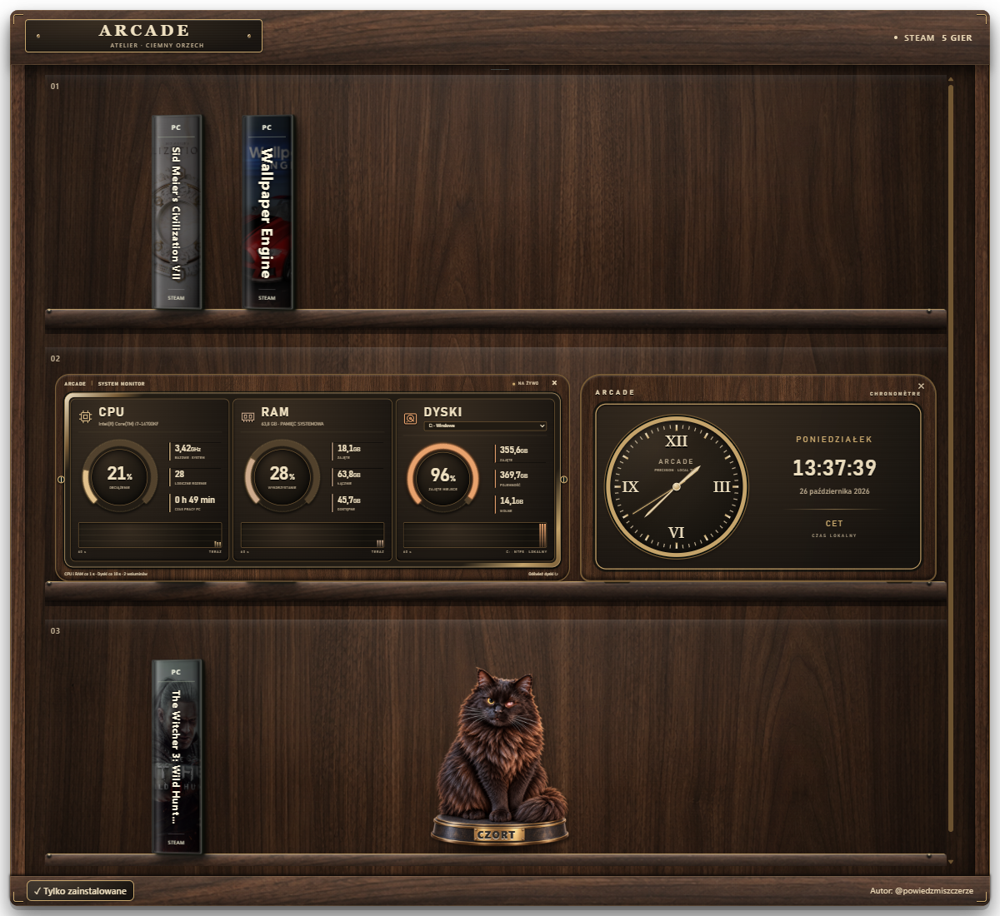
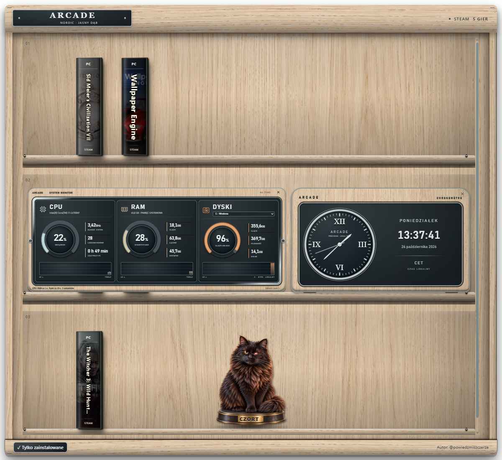
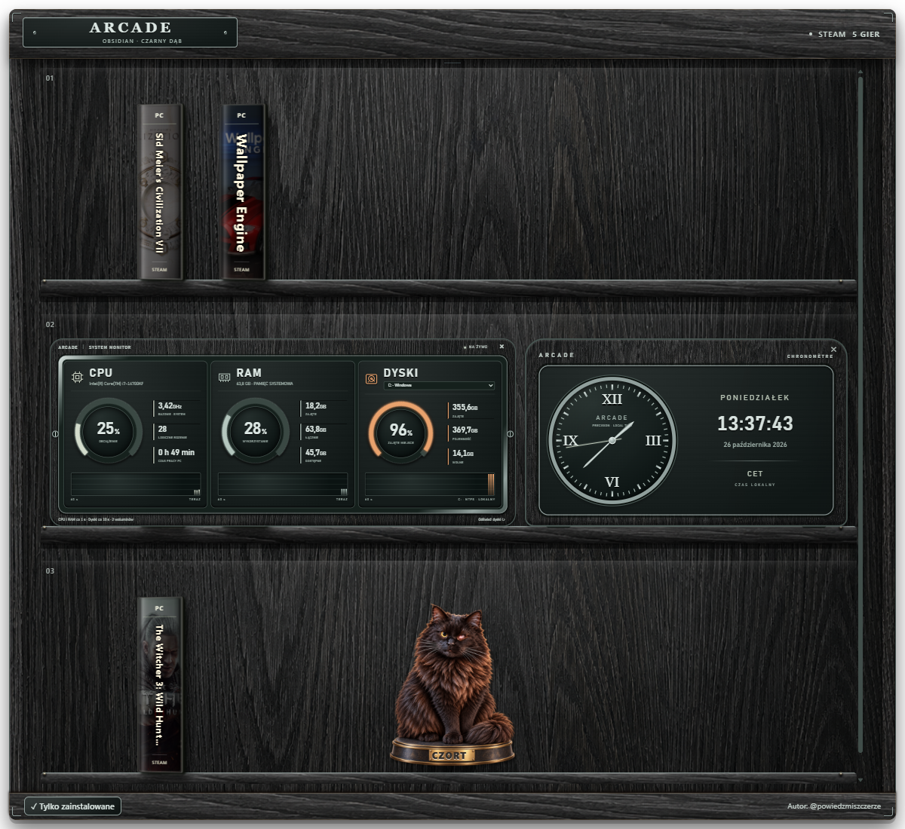
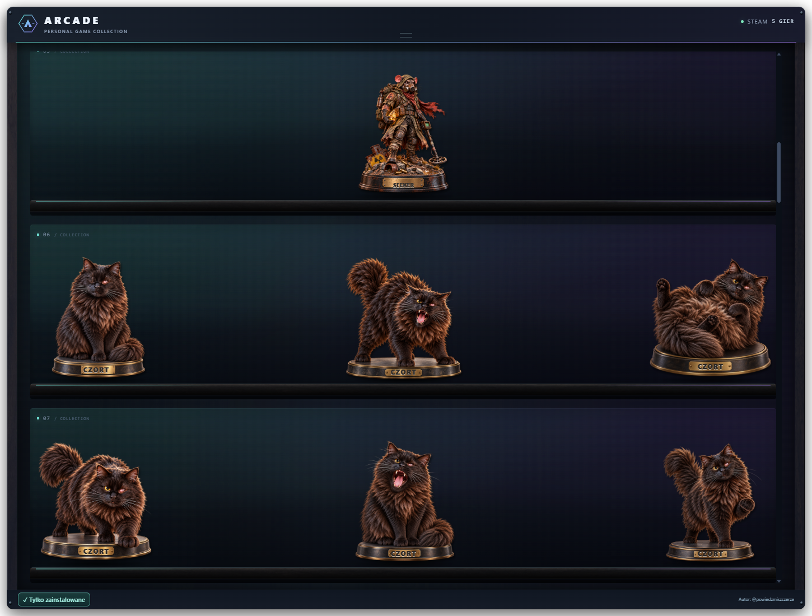

# ARCADE — Twoja półka gier

Biblioteka Steam i GOG jako przestrzenna półka na pulpicie Windows. Pudełka ustawiasz po swojemu, figurki zdobią regał, a zegar i monitor komputera stoją obok gier.

**[Pobierz instalator ARCADE 0.20.1](https://github.com/codewojcik-arch/arcade-game-shelf/releases/download/v0.20.1/ARCADE-Setup-0.20.1-win-x64.exe)** · [Wersja ZIP](https://github.com/codewojcik-arch/arcade-game-shelf/releases/download/v0.20.1/ARCADE-0.20.1-win-x64.zip) · [Historia zmian](CHANGELOG.md)

## Pytania i propozycje zmian

[Dołącz do Discorda ARCADE](https://discord.gg/gC4QSrArH), aby zadawać pytania, zgłaszać błędy i proponować nowe funkcje. Link jest również w oknie „O aplikacji”.

## Dobrowolne wsparcie

Cała aplikacja ARCADE jest darmowa. Jeśli chcesz, możesz dobrowolnie wesprzeć jej rozwój: [☕ Postaw kawę autorowi](https://buycoffee.to/powiedzmiszczerze). Przycisk znajdziesz również w oknie „O aplikacji”, po kliknięciu podpisu autora na półce.

## Cztery realistyczne motywy

W menu ARCADE obok zegara systemowego wybierz **Motyw graficzny**. Każdy wariant dopasowuje drewno, metal, światło, filtr biblioteki, zegar, monitor i okna aplikacji.

| Motyw | Materiały |
| --- | --- |
| Orzech i mosiądz | Zachowany dotychczasowy motyw realistyczny |
| Atelier | Ciemny amerykański orzech, satynowy mosiądz i ciepłe światło |
| Nordic | Naturalny jasny dąb, szczotkowane aluminium i czytelne grafitowe instrumenty |
| Obsidian | Czarny dąb, grafit i przygaszone metalowe akcenty |

### Atelier

### Nordic

### Obsidian

Dotychczasowe motywy Klasyczny, Night Shift, Aurora i Szlak Wilka zostały usunięte. Zapisany wybór wycofanego motywu przechodzi na Orzech i mosiądz, z zachowaniem układu gier, figurek i widgetów.

## Biblioteka Steam i GOG

- Automatyczne wykrywanie zainstalowanych gier Steam i pobieranie okładek.
- Opcjonalne połączenie kont Steam i GOG, by pokazać również posiadane niezainstalowane tytuły.
- Filtr **Tylko zainstalowane / Wszystkie gry** na dole półki i w menu obok zegara.
- Pobieranie dostępnych instalatorów posiadanych gier GOG po połączeniu konta.
- Przeciąganie pudełek między półkami i zapamiętywanie ustawień.
- Kliknięcie grzbietu otwiera pudełko, animację płyty i napędu oraz przycisk uruchomienia gry. Animację można pominąć.

## Zegar i monitor na półce

Włącz **Zegar na półce** lub **Monitor komputera → Pokaż monitor** w menu obok zegara systemowego. Oba widgety przeciągniesz za górny pasek na inną półkę. Pozycje i widoczność są zapamiętywane; instrumenty dopasowują się do dostępnego miejsca.

Zegar pokazuje wskazówki z płynnym sekundnikiem, cyfrową godzinę, polską datę i strefę Windows. Monitor prezentuje rzeczywiste obciążenie CPU, wykorzystanie RAM, czas pracy PC i zajętość wybranego dysku.

Panel **DYSKI** wykrywa dostępne lokalne woluminy Windows, np. C: i D:, oraz podłączone dyski USB. Pokazuje zajęte i wolne GB oraz pojemność. Zapamiętuje wybrany dysk, odświeża dane co 10 sekund i ma przycisk ręcznego odświeżania. Monitor działa bez dodatkowych programów do czujników.

## Figurki kolekcjonerskie

Na półkach możesz ustawić sześć realistycznych figurek Czorta i sześciu szczurzych antybohaterów. Mają grawerowane imiona i indywidualnie zapamiętywane pozycje. Przeciągnij podstawkę, aby przestawić figurkę. Czort zachowuje oryginalny wygląd oczu bez animacji mrugania. Szczurza kolekcja ma dopasowane efekty światła, dymu i rekwizytów.

## Powitanie od autora

Nowa ilustracja gracza i psotnego kota wita po uruchomieniu ARCADE: lekkie kołysanie, zabawny dymek i podziękowanie za korzystanie z aplikacji. Powitanie trwa 3,8 sekundy i można je pominąć. Nie pojawia się podczas otwierania gier. Aplikacja respektuje ograniczenie ruchu w systemie.

## Instalacja i obsługa

1. Pobierz **ARCADE-Setup-0.20.1-win-x64.exe** z sekcji Releases i uruchom instalator.
2. Przy aktualizacji wybierz dotychczasowy folder aplikacji. Ustawienia pozostają zachowane.
3. Steruj aplikacją z jej ikony obok zegara Windows. Tam zmienisz motyw, widoczność kolekcji, autostart i sprawdzisz aktualizacje.

Wersję ZIP rozpakuj w całości i uruchom **ARCADE.exe**. Zachowaj razem folder `runtime`, grafiki i pliki aplikacji. Wymagany Windows 10/11 x64. Nowe wydania są dostępne również przez kartę aktualizacji w aplikacji.

Górny uchwyt pozwala przesuwać regał, krawędzie zmieniają jego rozmiar, a przeciągnięcie do góry ekranu dopasowuje go do obszaru roboczego. Skalowanie obsługuje Full HD, 1440p i 4K.

## Autor

**[@powiedzmiszczerze na TikToku](https://www.tiktok.com/@powiedzmiszczerze)**

Publiczne repozytorium zawiera opis, grafiki i wydania aplikacji. Kod źródłowy jest przechowywany prywatnie. [Informacje o składnikach i licencjach](THIRD_PARTY_NOTICES.md).
