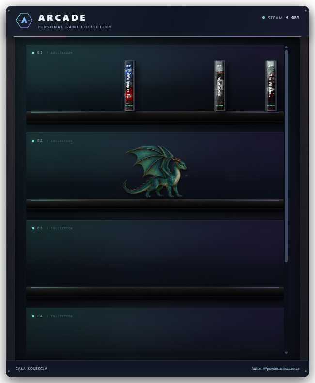
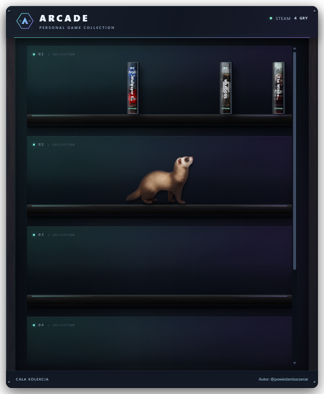
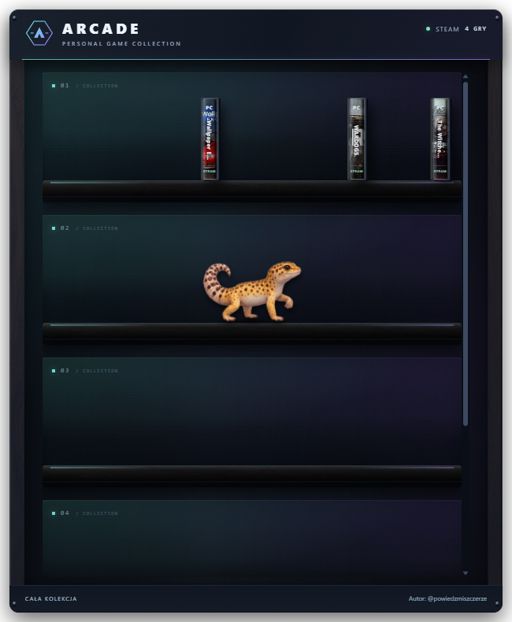
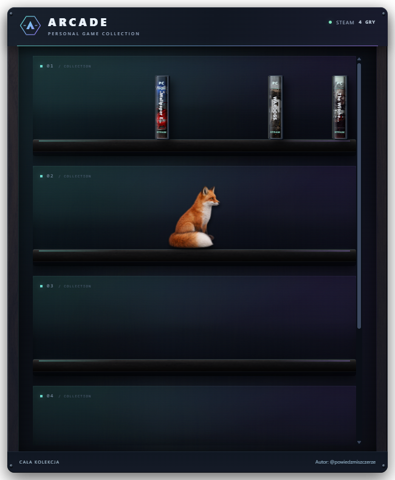

  <strong>Twoje gry. Twoja półka. Twój styl.</strong> 
  Gamingowy widget Steam na pulpit Windows — od @powiedzmiszczerze.

  <a href="https://github.com/codewojcik-arch/arcade-game-shelf/releases/latest">Pobierz na Windows</a> ·
  <a href="https://www.tiktok.com/@powiedzmiszczerze">TikTok autora</a> ·
  <a href="https://github.com/codewojcik-arch/arcade-game-shelf/issues">Zgłoś problem / pomysł</a>

---

## Zmień bibliotekę Steam w część swojego setupu

ARCADE zamienia listę gier w przestrzenną kolekcję pudełek na półkach. Ustaw widget na pulpicie, przeciągnij pudełka tak, jak lubisz, i wybierz grę. Towarzyszyć Ci może kot, szczur, smok, fretka, gekon lub lis — czasem zrzuci pudełko, które po chwili samo wróci na miejsce.

## Nowe pety w wersji 0.2.0

Smok, fretka, gekon i lis dołączają do kota i szczura. Każda nowa postać ma 16 póz, w tym osiem klatek chodu. Wybór: **ikona obok zegara → Pet na półce**.

<table><tr><td><strong>Smok</strong> </td><td><strong>Fretka</strong> </td></tr><tr><td><strong>Gekon</strong> </td><td><strong>Lis</strong> </td></tr></table>

## Co potrafi ARCADE?

| Funkcja | Jak działa |
| --- | --- |
| Twoja kolekcja Steam | Automatyczne wykrywanie zainstalowanych gier i pobieranie okładek. |
| Cała biblioteka | Połączenie przez Steam Web API pokazuje także posiadane, niezainstalowane gry. |
| Układ po swojemu | Przeciąganie pudełek między półkami, zapis układu i dopasowanie do okna. |
| Grzbiety lub fronty | Wybór pudełek ustawionych krawędzią z tytułem albo okładką do przodu. |
| Gamingowy wygląd | Motyw Night Shift: grafit, ciemne drewno oraz turkusowo-fioletowe światło. Dostępne także dwa inne motywy. |
| Klimat lat 90. | Animowane pudełko, wyciąganie płyty i wkładanie jej do napędu retro PC. |
| Sześć petów | Kot, szczur, smok, fretka, gekon lub lis: spacer, odpoczynek i okazjonalne strącanie pudełka. |
| Wygodny pulpit | Menu obok zegara, opcjonalny autostart i tryb zawsze na wierzchu. |

## Pobierz i uruchom

1. Przejdź do **[Releases](https://github.com/codewojcik-arch/arcade-game-shelf/releases/latest)** i pobierz `ARCADE-0.2.0-win-x64.zip`.
2. Wypakuj **cały folder** w miejsce, w którym możesz zapisywać pliki.
3. Uruchom **ARCADE.exe**. Nie przenoś samego EXE — wymaga pozostałych plików w paczce.
4. Ustawienia i zamknięcie aplikacji znajdziesz pod ikoną ARCADE obok zegara Windows, czasem pod strzałką ukrytych ikon.

**Wymagania:** Windows 10/11 64-bit, Steam i połączenie z internetem do pierwszego pobrania okładek. Gotowa paczka ma dołączony runtime — nie wymaga osobnego Node.js. Wersja 0.2.0 jest wersją poglądową; wygląd i zachowanie mogą jeszcze się zmieniać.

Przesuwaj widget za górną listwę. Dwuklik listwy powiększa lub przywraca szafkę; przeciągnięcie do górnej krawędzi ekranu i puszczenie również ją powiększa. Zamknięcie z menu w zasobniku kończy aplikację.

## Wszystkie gry czy tylko zainstalowane?

W menu obok zegara wybierz **Biblioteka Steam → Tylko zainstalowane / Wszystkie posiadane gry**. Aplikacja zapamięta wybór.

Zainstalowane gry są wykrywane lokalnie bez klucza API. Pełna lista posiadanych gier wymaga jednorazowego wejścia w **Połącz konto / ustawienia** i wklejenia własnego klucza Steam Web API. SteamID jest wykrywany automatycznie; można go zmienić. Przycisk w formularzu otwiera oficjalną stronę Steam. Szczegóły gier na profilu muszą być dostępne dla API. Aplikacja nie pyta o hasło do Steam.

Przycisk **Zainstaluj w Steam** otwiera instalację niezainstalowanej gry w kliencie Steam. ARCADE nie pobiera plików gier samodzielnie i nie zastępuje Steam.

## Mały towarzysz na półce

Menu **Pet na półce** pozwala wybrać kota, szczura, smoka, fretkę, gekona, lisa lub wyłączyć zwierzaka. Nowe postacie mają po osiem klatek spaceru, sen, pielęgnację, rozglądanie, przeciąganie i strącanie przednią łapką. Smok dodatkowo rozkłada skrzydła i wypuszcza delikatny dymek, fretka węszy, gekon unosi łapkę, a lis siada z ogonem owiniętym wokół łap. Kot strąca pudełko przednią łapką; pudełko wraca samo, bez zmiany zapisanego układu i bez ingerencji w pliki gry. Systemowe ograniczenie ruchu wyłącza psoty.

## Dane i prywatność

- Ustawienia, układ, okładki i ostatnia pobrana lista gier są zapisywane lokalnie w `cache/`.
- Klucz Steam Web API jest zapisywany lokalnie w `cache/steam/connection.json` i używany do zapytań do oficjalnego API Steam. Nie udostępniaj tego pliku.
- Gotowa paczka nie zawiera konta, klucza API, ustawień ani zapisanej biblioteki autora.
- Okładki są pobierane z usług Steam/Valve. Odnośnik do TikToka otwiera profil autora po kliknięciu.

Przed przeniesieniem folderu aplikacji wyłącz autostart. Po przeniesieniu włącz go ponownie, aby Windows zapamiętał nową lokalizację EXE.

## Problemy i pomysły

Zgłoszenia przyjmuję przez [Issues](https://github.com/codewojcik-arch/arcade-game-shelf/issues). Opisz, co się stało, podaj wersję Windows i aplikacji oraz kroki do odtworzenia. Nie dołączaj klucza API, pliku połączenia ani całego folderu `cache/`.

## Autor

**[@powiedzmiszczerze](https://www.tiktok.com/@powiedzmiszczerze)** — aktualności i prezentacje na TikToku.

Aplikacja jest dostępna bezpłatnie do użytku osobistego. Kod źródłowy jest przechowywany w oddzielnym prywatnym repozytorium. Projekt nie jest udostępniany na licencji MIT ani innej licencji open source. Warunki używania: [LICENSE](LICENSE). Electron, Steam oraz nazwy i grafiki gier zachowują prawa i licencje swoich właścicieli — zobacz [THIRD_PARTY_NOTICES.md](THIRD_PARTY_NOTICES.md). ARCADE nie jest oficjalnym produktem Valve.
