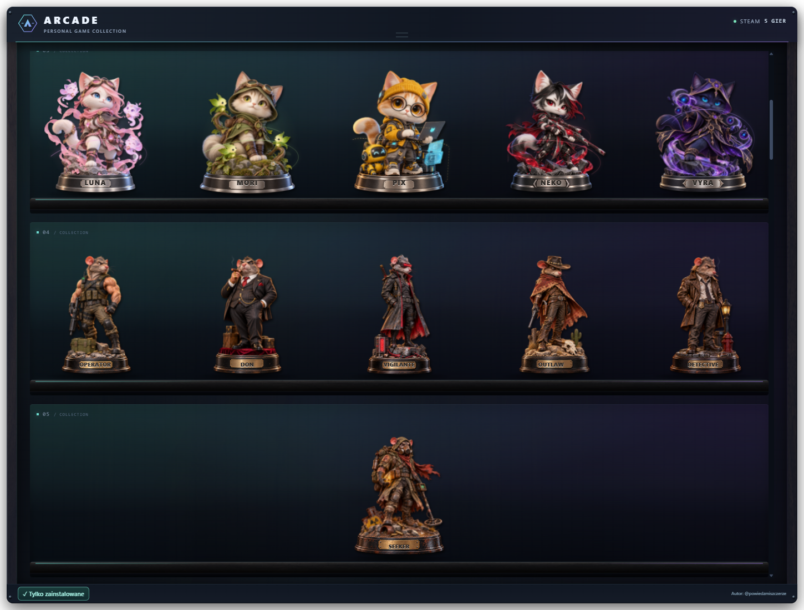
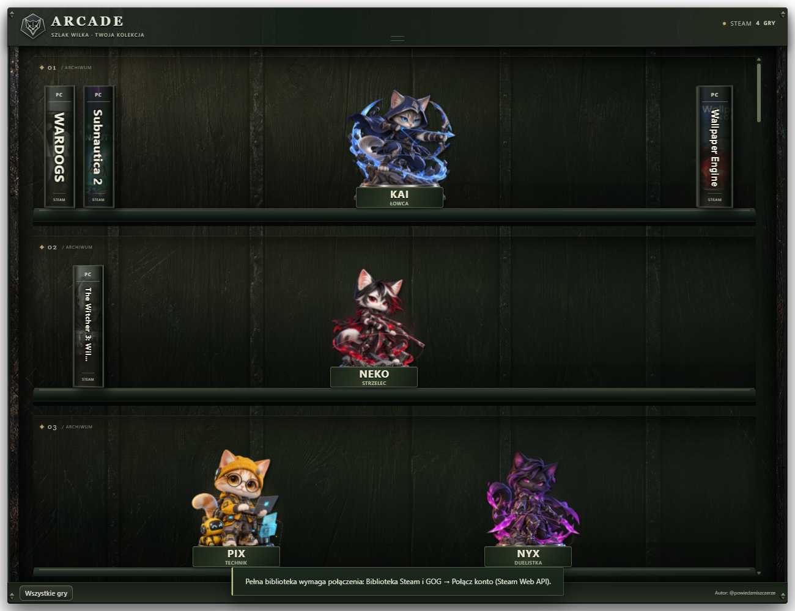
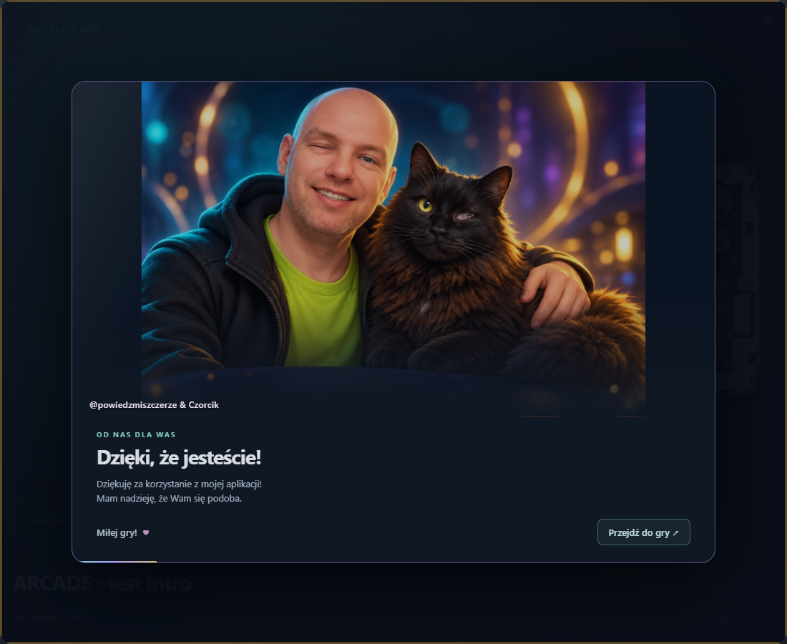
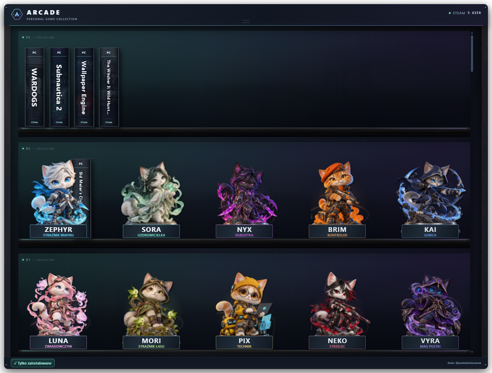
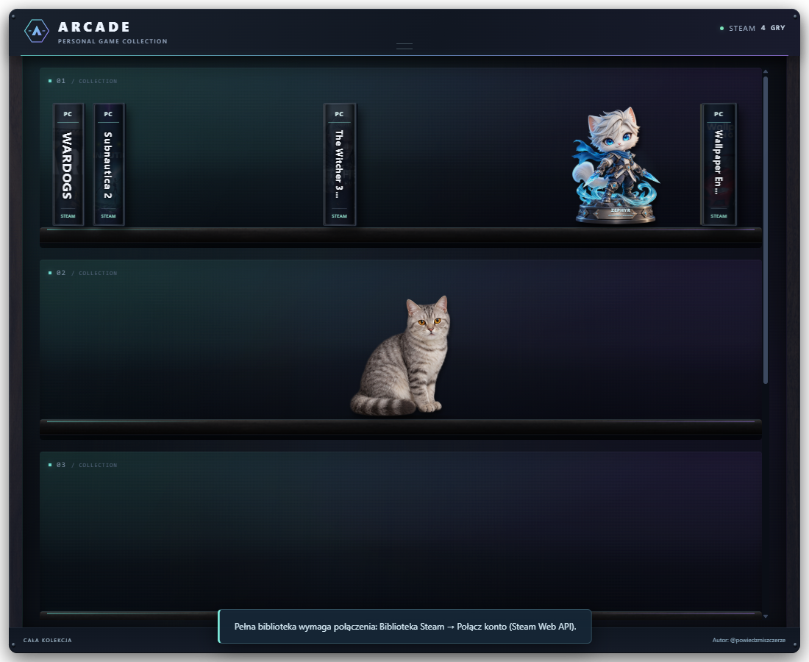
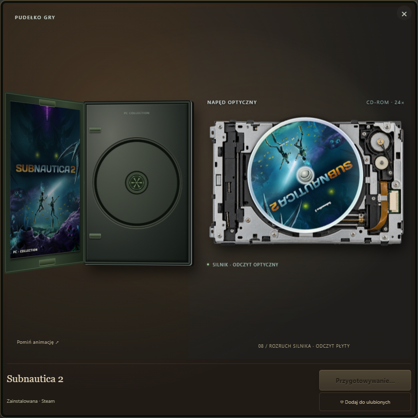

  <strong>Twoje gry. Twoja półka. Twój styl.</strong> 
  Gamingowy widget Steam i GOG na pulpit Windows — od @powiedzmiszczerze.

  <a href="https://github.com/codewojcik-arch/arcade-game-shelf/releases/latest">Pobierz na Windows</a> ·
  <a href="https://www.tiktok.com/@powiedzmiszczerze">TikTok autora</a> ·
  <a href="https://github.com/codewojcik-arch/arcade-game-shelf/issues">Zgłoś problem / pomysł</a>

---

## Zmień bibliotekę Steam i GOG w część swojego setupu

ARCADE zamienia listę gier w przestrzenną kolekcję pudełek na półkach. Ustaw widget na pulpicie, przeciągnij pudełka tak, jak lubisz, i wybierz grę. Półki możesz ozdobić kolekcją animowanych figurek.

## 0.14.0 — szczurzy antybohaterowie

- Sześć nowych figurek: Operator, Don, Vigilante, Outlaw, Detective i Seeker.
- Mruganie odsłoniętymi oczami, dym i żar cygara/papierosa, pulsujący wizjer i radio, pustynny pył, światło latarni oraz artefakt i ekran detektora.
- Własne efekty przy rekwizytach każdej figurki, grawerowane imiona i niezależne przestawianie.
- Dwie serie w menu obok zegara; można pokazać lub ukryć całą serię. Dodatkowe półki mieszczą nową kolekcję bez przestawiania zapisanych gier.
- Animacje respektują ograniczenie ruchu i pauzują podczas otwierania gier.

## 0.13.1 — imiona grawerowane na podstawach

- Na figurkach pozostają tylko imiona, bez podpisów ról.
- Napisy znajdują się na metalowym froncie oryginalnej podstawy z efektem zagłębionego graweru.
- Imiona poruszają się razem z podstawą; usunięte osobne prostokątne etykiety i ich wariant w motywie Szlak Wilka.

## 0.13.0 — półka bez petów i poprawiony Brim

- Usunięte wszystkie pety, ich animacje, grafiki i opcje w menu.
- Aktualizacja sprząta stare pliki petów; biblioteka, układ gier i figurki pozostają zachowane.
- Poprawiona figurka Brim: dwoje uszu, bez dodatkowego ucha za beretem.

## 0.11.0 — Szlak Wilka

- Nowy motyw dark fantasy inspirowany wiedźmińskim klimatem: przydymiony dąb, ciemne żelazo, srebrne okucia i spokojne światło.
- Autorska tekstura drewna, wektorowy medalion wilka, nagłówki w stylu dawnych ksiąg i czytelne tytuły pudełek.
- Spójna oprawa filtra biblioteki, tabliczek figurek, okien uruchamiania gry, Steam, GOG, aktualizacji oraz planszy powitalnej.
- Delikatna animacja światła półek z obsługą ograniczonego ruchu.
- Motyw dostępny obok pozostałych: menu obok zegara → Motyw graficzny → Dark fantasy · Szlak Wilka. Wybór jest zapamiętywany.

## 0.10.1 — podziękowanie wyłącznie na starcie aplikacji

- Plansza autora i Czorcika pojawia się automatycznie po uruchomieniu ARCADE, bez klikania gry.
- Nie pojawia się podczas wybierania ani uruchamiania gier. Pudełko i płyta startują od razu.
- Przycisk „Przejdź do półki”, automatyczne zamknięcie po 3,8 sekundy oraz jednokrotne pokazanie w danym uruchomieniu aplikacji.
- Sprawdzono pełny start, pomijanie, automatyczne zamknięcie, ponowne uruchomienie oraz brak podziękowania w pudełkach.

## 0.10.0 — autor, Czorcik i oprawa filtra

- Autorska ilustracja 3D przedstawiająca @powiedzmiszczerze z kotem Czorcikiem, przygotowana ze zdjęć referencyjnych.
- Krótkie podziękowanie przy wybieraniu gry, przed dotychczasową animacją pudełka i napędu: płynne pojawienie, delikatne zbliżenie, refleks światła i tekst.
- Przycisk „Przejdź do gry”, automatyczne przejście po 3,8 sekundy i obsługa ograniczonego ruchu. Zamknięcie okna anuluje przejście.
- Przełącznik „Wszystkie gry / Tylko zainstalowane” dobiera tło, obrys, tekst i aktywny stan do motywu: Klasyczny, Orzech i mosiądz, Gaming oraz Aurora.
- Skalowanie podziękowania od małego widgetu do Full HD, 1440p i 4K.

## 0.9.1 — ukrywanie niezainstalowanych gier

- Przełącznik „Wszystkie gry / Tylko zainstalowane” bezpośrednio na dole półki, dostępny w każdym motywie.
- Szybka opcja „Ukryj niezainstalowane gry” w głównym menu obok zegara.
- Wspólny filtr dla Steam i GOG, zapamiętywany po zamknięciu aplikacji. Przełączenie widoku zachowuje ustawienie pudełek.
- Połączenie z GOG zachowuje wybrany filtr zamiast automatycznie pokazywać całą bibliotekę.
- Pusta półka pokazuje komunikat zamiast przykładowych niezainstalowanych gier.

Sprawdzono przełączanie na mieszanej bibliotece Steam i GOG, zapis ustawienia, pustą bibliotekę oraz klikalność przycisku we wszystkich czterech motywach.

## 0.9.0 — biblioteka GOG i pobieranie gier

- Logowanie na oficjalnej stronie GOG w osobnym oknie i zapamiętywanie sesji lokalnie. Bez formularza hasła w ARCADE.
- Import posiadanych gier GOG, również ukrytych, oraz automatyczne okładki. Wspólna półka Steam i GOG z oznaczeniem sklepu.
- Wybór instalatorów Windows według języka i rozmiaru, pobieranie do wybranego folderu, postęp, anulowanie i pokazanie pobranego pliku.
- Wykrywanie gier zarejestrowanych przez instalatory GOG na Windows i ich uruchamianie z półki.
- Filtr wszystkich lub tylko zainstalowanych gier, zapisywanie ustawienia pudełek oraz panel skalujący się od małego widgetu do 4K.
- Odłączenie konta usuwa lokalną sesję i zaimportowaną listę.

Po aktualizacji: menu obok zegara → Biblioteka Steam i GOG → GOG · połącz konto / pobieranie. Po zalogowaniu wybierz grę na półce i kliknij „Pobierz z GOG”. Przy instalatorach wieloczęściowych pobierz .exe i wszystkie odpowiadające pliki .bin do jednego folderu, potem uruchom instalator.

Testy: import wielostronicowy, ukryte gry, zmiana konta, tryb offline, sprawdzenie uprawnień do plików oraz pobieranie pliku testowego w natywnym oknie. Sprawdzono otwarcie formularza GOG bez zalogowania; pełny import i pobieranie z rzeczywistego konta wymagają zalogowania użytkownika.

## 0.8.1 — oczy, woda i ogień figurek

- Indywidualnie dopasowane mruganie i subtelny ruch spojrzenia wszystkich dziesięciu kotów.
- Falowanie i refleksy na błękitnych smugach Zephyra oraz Kaia; migoczące płomienie, ciepłe światło i żar u Brima oraz Neko.
- Dopasowany ruch miętowej energii Sory, kryształów Nyx, duchów Luny, zieleni Mori, hologramów Pixa i kul Vyry.
- Efekty ograniczone do właściwych fragmentów ilustracji. Animacje wstrzymują się poza widokiem oraz podczas uruchamiania gry.

## 0.8.0 — pełna animowana kolekcja kotów

- Dziesięć figurek: Zephyr, Sora, Nyx, Brim, Kai, Luna, Mori, Pix, Neko i Vyra.
- Subtelny ruch postaci przy nieruchomych podstawkach, animowane efekty dopasowane do żywiołu oraz krótka reakcja po kliknięciu podstawki.
- Same imiona z efektem graweru na przedniej części metalowych podstawek. Napisy zachowują perspektywę podstawy.
- Osobne przestawianie, zapisywanie i włączanie każdej figurki. Menu obok zegara pozwala pokazać lub ukryć cały zestaw.
- Zachowane ustawienia Zephyra z poprzedniej wersji, układanie wielu figurek bez nachodzenia na siebie i skalowanie do 4K.

## 0.7.0 — pierwsza figurka kolekcjonerska

- Zephyr · Strażnik Wiatru: autorska figurka białego kota na metalowej podstawce, z niebieskimi kryształami i efektem energii.
- Szczegółowy render z wyglądem 3D, delikatne przechylenie, połysk i cień na półce.
- Przeciąganie za podstawkę między półkami oraz zapisywanie pozycji.
- Menu obok zegara: Figurki kolekcjonerskie → pokaż/ukryj Zephyra lub przywróć pozycję.
- Skalowanie do wielkości półek; sylwetka figurki przepuszcza kliknięcia do gier, aktywna jest tylko podstawka.

## 0.6.12 — stabilny obszar klikania pudełek

- Naprawiono kliknięcia przy dolnej krawędzi pudełka: efekt najechania nie podnosi już przycisku spod kursora.
- Zachowano podświetlenie, obrys i rozjaśnienie gry w każdym motywie.
- Kliknięcie działa bez konieczności przenoszenia pudełka na inną półkę.
- Dodano testy górnej i dolnej krawędzi oraz środka pudełek na każdej półce w motywach Realistycznym, Gaming i Aurora.

## 0.6.10 — pełnoekranowe pudełko i napęd

- Widok uruchamiania wypełnia całe okno aplikacji.
- Pudełko, napęd i płyta skalują się do szerokości oraz wysokości, bez stałego limitu wielkości.
- Czytelniejsze, skalowane przyciski i tekst; pionowy układ na wąskich ekranach.
- Zachowano wkładanie płyty od góry i jej nadruk.

## 0.6.9 — wkładanie płyty od góry

- Usunięto szufladkę napędu.
- Płyta unosi się z pudełka, ustawia nad napędem i delikatnie opada na trzpień.
- Osadzenie i docisk poprzedzają rozruch silnika; zachowano nadruk wybranej gry.

## 0.6.8 — duże pudełko i napęd

- Usunięto grafikę komputera z animacji uruchamiania gry.
- Powiększone pudełko po lewej i samodzielny napęd z obracającą się płytą po prawej.
- Tacka wysuwa się bezpośrednio z napędu; płyta zachowuje grafikę wybranej gry.
- Układ dopasowuje się do rozmiaru okna, a na wąskim ekranie elementy ustawiają się jeden pod drugim.

## 0.6.1 — poprawione klikanie gier

- Kliknięcie pudełka otwiera animację również przy drobnym ruchu myszy.
- Przeciąganie zaczyna się po wyraźnym ruchu; puszczenie pudełka zapisuje pozycję bez otwierania gry.
- Po przestawieniu gry można od razu ponownie otworzyć pudełko.

## 0.6.0 — aktualizacje prosto z aplikacji

ARCADE sprawdza GitHub przy uruchomieniu, co godzinę i po wybudzeniu komputera. Gdy pojawi się nowsze stabilne wydanie, kafelek pokazuje **numer wersji, co nowego i przycisk Zaktualizuj i uruchom ponownie**.

Aplikacja pobiera oficjalny instalator, weryfikuje sumę SHA-256, aktualizuje ten sam folder i uruchamia się ponownie. Układ półki, figurki, motyw i połączenie Steam są zachowane. Po przejściu na aktualną wersję kafelek oraz lista zmian znikają. Można też wybrać **Sprawdź aktualizacje** w menu obok zegara.

_Zrzut przedstawia dane testowe kafelka, a nie zapowiedź konkretnego wydania._

**Ważne przy przejściu ze starszych wersji:** instalator 0.6.0 trzeba uruchomić raz ręcznie. Dopiero ta wersja dodaje aktualizowanie z aplikacji. Sprawdzanie nie wymaga logowania do GitHuba. Bez połączenia powiadomienie nie blokuje półki; nieudane pobieranie można ponowić. Instalacja rozpoczyna się po kliknięciu przycisku przez użytkownika.

## Nadruki płyt i wnętrze napędu

Każda płyta ma nadruk z okładki wybranej gry: w otwartym pudełku, podczas przenoszenia, na tacce i wewnątrz napędu. Pudełko otwiera się na zawiasie, odsłania wkładkę, zaczepy i uchwyt płyty. Nowa grafika komputera retro i zbliżenie mechanizmu pokazują docisk, rozruch płyty oraz ruch głowicy optycznej.

Pełna sekwencja trwa około 10 sekund. **Pomiń animację** od razu udostępnia przycisk **Graj**. Systemowe ograniczenie ruchu pomija przejścia i obrót. Gdy nie uda się pobrać okładki, płyta zachowuje czytelny tytuł.

## Grzbiety i otwieranie gier

Na półce pozostaje jeden widok: **grzbiety z tytułami**. Widok okładek przodem został usunięty. Kliknięcie gry otwiera animowane pudełko, wkłada płytę do napędu retro PC i odblokowuje przycisk **Graj**. Następne kliknięcie odzyskuje działanie również po przerwanym przeciąganiu.

## Instalator i Aurora Circuit

Pobierz **ARCADE-Setup-0.14.0-win-x64.exe** z najnowszego wydania. Polski instalator dodaje skróty i wpis do odinstalowania; nie wymaga konta administratora. Opcjonalnie włącza start z Windows.

**Aurora Circuit** to czwarty motyw: ruchome światło zorzy, delikatne cząsteczki, obwody oraz sygnały LED na półkach. Włączysz go przez **ikonę obok zegara → Motyw graficzny → Animowany · Aurora Circuit**. Animacje respektują systemowe ograniczenie ruchu i pauzują po ukryciu okna.

## Skalowanie i dynamiczne okno

Większe pudełka i dopasowane do długości tytułów napisy. Przeciągnij górną listwę do górnej krawędzi monitora: zobaczysz podświetlony podgląd docelowego obszaru. Puść, aby dopasować szafkę do dostępnego ekranu, lub odsuń kursor, aby anulować podgląd. Zmieniaj rozmiar za dowolną krawędź lub narożnik; podczas przeciągania widać aktualne wymiary. Nadmiar gier i półek jest przewijany, żeby zachować czytelność.

## Co potrafi ARCADE?

| Funkcja | Jak działa |
| --- | --- |
| Twoja kolekcja Steam | Automatyczne wykrywanie zainstalowanych gier i pobieranie okładek. |
| Cała biblioteka | Połączenie przez Steam Web API pokazuje także posiadane, niezainstalowane gry. |
| Układ po swojemu | Przeciąganie pudełek między półkami, zapis układu i dopasowanie do okna. |
| Grzbiety z tytułami | Gry ustawione krawędzią pudełka; kliknięcie otwiera pudełko i animację płyty. |
| Gamingowy wygląd | Motyw Night Shift: grafit, ciemne drewno oraz turkusowo-fioletowe światło. Dostępne także Aurora Circuit, motyw realistyczny i klasyczny. |
| Klimat lat 90. | Animowane pudełko, wyciąganie płyty i wkładanie jej do napędu retro PC. |
| Wygodny pulpit | Menu obok zegara, opcjonalny autostart i tryb zawsze na wierzchu. |

## Pobierz i uruchom

1. Przejdź do **[Releases](https://github.com/codewojcik-arch/arcade-game-shelf/releases/latest)** i pobierz **ARCADE-Setup-0.14.0-win-x64.exe**.
2. Uruchom instalator, wybierz folder i opcjonalne skróty oraz autostart.
3. Po instalacji uruchom **ARCADE** z menu Start lub pulpitu.
4. Ustawienia, motywy, figurki i zamknięcie znajdziesz pod ikoną obok zegara Windows.

Alternatywnie pobierz **ARCADE-0.14.0-win-x64.zip**, wypakuj cały folder i uruchom ARCADE.exe. Samo EXE wymaga pozostałych plików paczki. Instalator zachowuje lokalny folder cache podczas aktualizacji i odinstalowania; może zawierać ustawienia oraz zapisane połączenie Steam i sesję GOG. Możesz usunąć ten folder samodzielnie po odinstalowaniu.

**Wymagania:** Windows 10/11 64-bit, Steam i internet do pobrania okładek. Runtime jest dołączony — nie instalujesz osobno Node.js. Okna Full HD, 1440p i 4K są objęte testami układu. Instalator nie ma jeszcze komercyjnego podpisu cyfrowego; Windows może pokazać nieznanego wydawcę. Pobieraj z oficjalnego repozytorium.

Przesuwaj widget za górną listwę. Dwuklik listwy powiększa lub przywraca szafkę; przeciągnięcie do górnej krawędzi ekranu i puszczenie również ją powiększa. Zamknięcie z menu w zasobniku kończy aplikację.

## Wszystkie gry czy tylko zainstalowane?

W menu obok zegara wybierz **Biblioteka Steam i GOG → Tylko zainstalowane / Wszystkie posiadane gry**. Aplikacja zapamięta wybór.

Zainstalowane gry są wykrywane lokalnie bez klucza API. Pełna lista posiadanych gier wymaga jednorazowego wejścia w **Połącz konto / ustawienia** i wklejenia własnego klucza Steam Web API. SteamID jest wykrywany automatycznie; można go zmienić. Przycisk w formularzu otwiera oficjalną stronę Steam. Szczegóły gier na profilu muszą być dostępne dla API. Aplikacja nie pyta o hasło do Steam.

Przycisk **Zainstaluj w Steam** otwiera instalację niezainstalowanej gry w kliencie Steam. ARCADE nie pobiera plików gier samodzielnie i nie zastępuje Steam.

## Konto GOG

W menu obok zegara wybierz **Biblioteka Steam i GOG → GOG · połącz konto / pobieranie**, a następnie **Połącz z GOG**. Zaloguj się na oficjalnej stronie GOG. Po połączeniu aplikacja zachowa wybrany filtr. Przycisk na dole półki przełącza widok między wszystkimi grami a tylko zainstalowanymi.

Kliknij pudełko GOG, pomiń lub obejrzyj animację i wybierz **Pobierz z GOG**. Panel pokazuje instalatory Windows z językiem, rozmiarem i postępem pobierania. Dla gier wieloczęściowych pobierz .exe i wszystkie części .bin do jednego folderu. Instalację uruchamiasz samodzielnie; ARCADE nie uruchamia automatycznie pobranych plików. Po instalacji odśwież bibliotekę. Wykrywanie obejmuje wpisy utworzone przez instalatory GOG w rejestrze Windows.

Przycisk **Odłącz** usuwa sesję GOG z aplikacji oraz zapamiętaną listę posiadanych gier. Nie usuwa gier ani pobranych instalatorów. Dane konta i ciasteczka pozostają wyłącznie w lokalnym folderze cache; nie dołączaj go do zgłoszeń. Obsługa GOG korzysta z interfejsów strony konta, które mogą zmieniać się po stronie sklepu.

## Dane i prywatność

- Ustawienia, układ, okładki i ostatnia pobrana lista gier są zapisywane lokalnie w `cache/`.
- Klucz Steam Web API jest zapisywany lokalnie w `cache/steam/connection.json` i używany do zapytań do oficjalnego API Steam. Nie udostępniaj tego pliku.
- Gotowa paczka nie zawiera konta, klucza API, ustawień ani zapisanej biblioteki autora.
- Okładki są pobierane z usług Steam/Valve. Odnośnik do TikToka otwiera profil autora po kliknięciu.

Przed przeniesieniem folderu aplikacji wyłącz autostart. Po przeniesieniu włącz go ponownie, aby Windows zapamiętał nową lokalizację EXE.

## Problemy i pomysły

Zgłoszenia przyjmuję przez [Issues](https://github.com/codewojcik-arch/arcade-game-shelf/issues). Opisz, co się stało, podaj wersję Windows i aplikacji oraz kroki do odtworzenia. Nie dołączaj klucza API, pliku połączenia ani całego folderu `cache/`.

## Autor

**[@powiedzmiszczerze](https://www.tiktok.com/@powiedzmiszczerze)** — aktualności i prezentacje na TikToku.

Aplikacja jest dostępna bezpłatnie do użytku osobistego. Kod źródłowy jest przechowywany w oddzielnym prywatnym repozytorium. Projekt nie jest udostępniany na licencji MIT ani innej licencji open source. Warunki używania: [LICENSE](LICENSE). Electron, Steam oraz nazwy i grafiki gier zachowują prawa i licencje swoich właścicieli — zobacz [THIRD_PARTY_NOTICES.md](THIRD_PARTY_NOTICES.md). ARCADE nie jest oficjalnym produktem Valve ani GOG.
