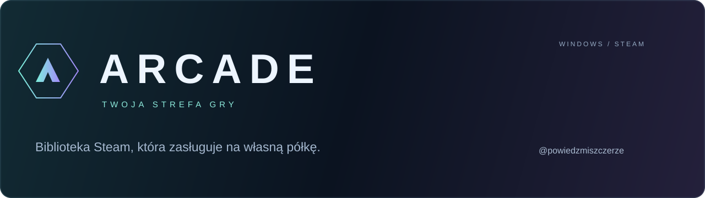
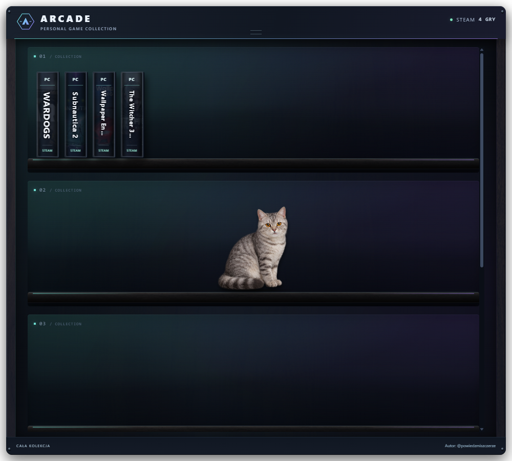
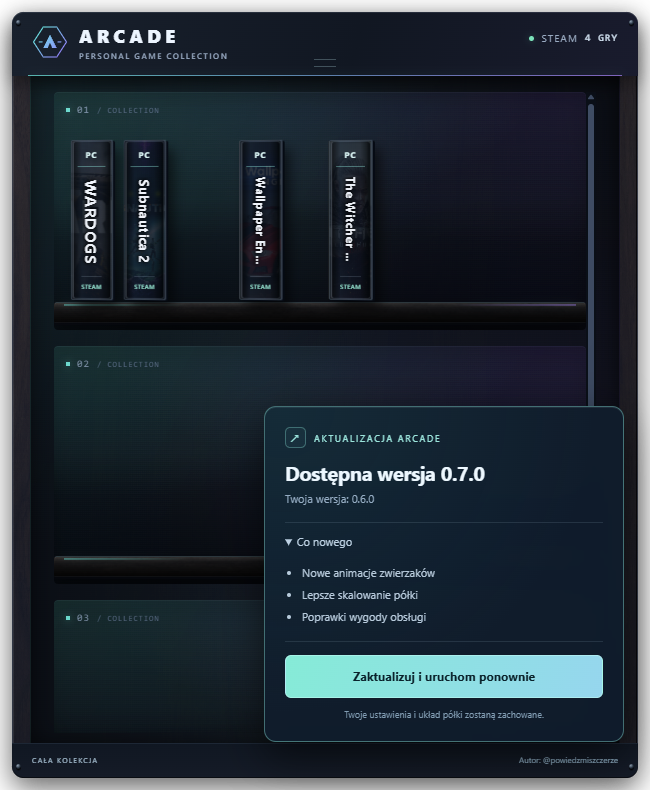
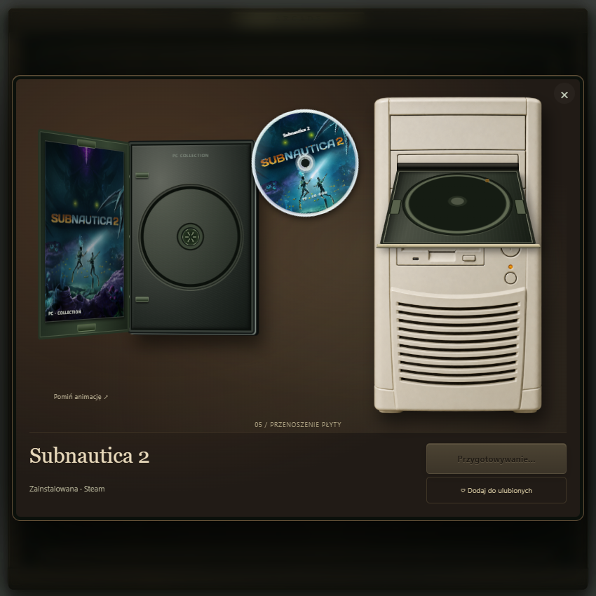
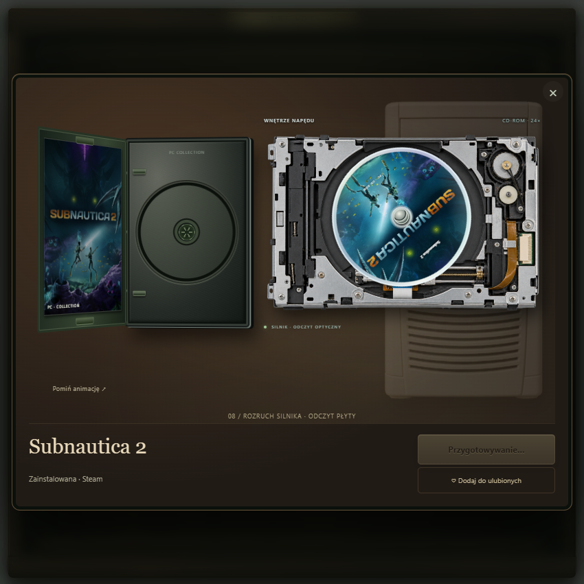
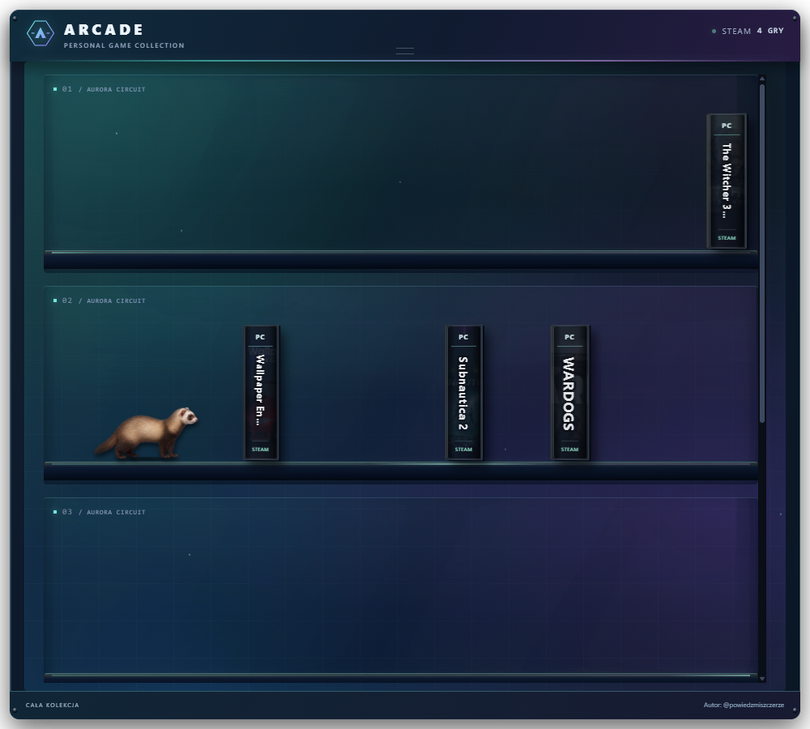
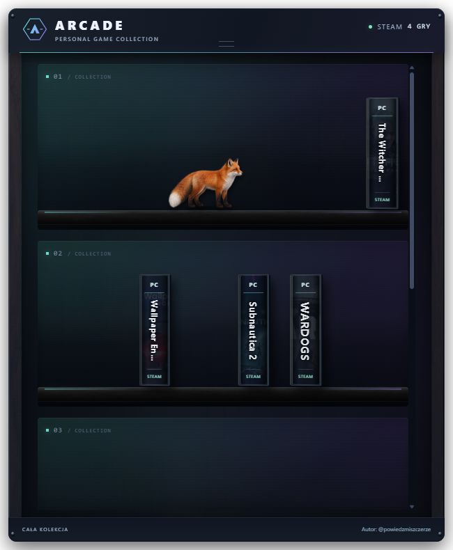
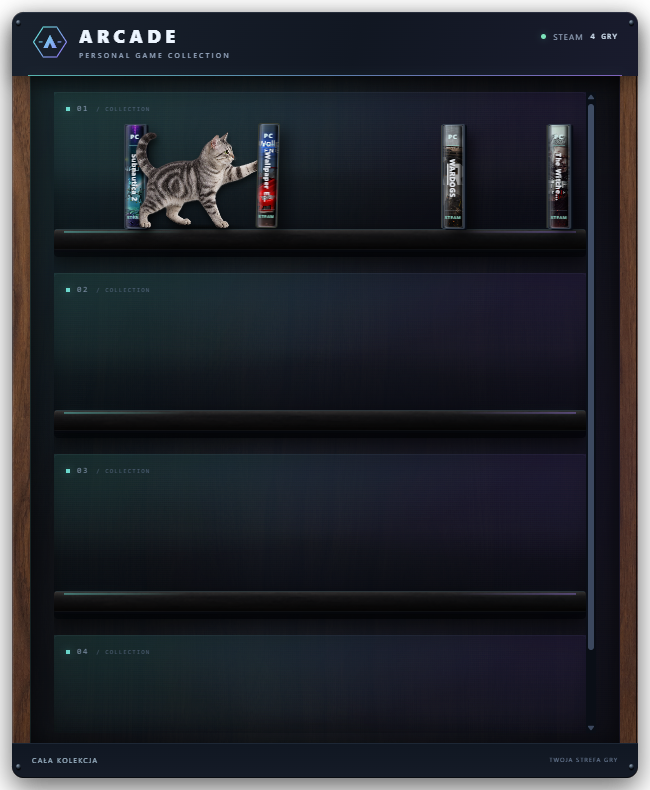

  <strong>Twoje gry. Twoja półka. Twój styl.</strong> 
  Gamingowy widget Steam na pulpit Windows — od @powiedzmiszczerze.

  <a href="https://github.com/codewojcik-arch/arcade-game-shelf/releases/latest">Pobierz na Windows</a> ·
  <a href="https://www.tiktok.com/@powiedzmiszczerze">TikTok autora</a> ·
  <a href="https://github.com/codewojcik-arch/arcade-game-shelf/issues">Zgłoś problem / pomysł</a>

---

## Zmień bibliotekę Steam w część swojego setupu

ARCADE zamienia listę gier w przestrzenną kolekcję pudełek na półkach. Ustaw widget na pulpicie, przeciągnij pudełka tak, jak lubisz, i wybierz grę. Towarzyszyć Ci może nowy srebrny kot, szczur, fretka lub gekon — czasem zrzuci pudełko, które po chwili samo wróci na miejsce.

## 0.6.7 — natychmiastowy powrót pudełka

- Po upadku do dołu okna i odbiciach pudełko od razu pojawia się z powrotem na półce.
- Usunięto animację cofania w górę; pozycja pudełka pozostaje zachowana.

## 0.6.6 — pudełka spadają do samego dołu

- Pudełko strącone przez zwierzaka spada aż do dolnej krawędzi okna, niezależnie od półki i rozdzielczości.
- Przyspieszanie podczas upadku, obrót, dwa odbicia i krótki odpoczynek na dole.
- Cień na podłodze, subtelny efekt uderzenia i płynny powrót na miejsce.
- Zachowany układ pudełek; przerwanie animacji przywraca oryginał.

## 0.6.5 — nowy srebrny kot

Nowy realistyczny kot w srebrne pręgi, z bursztynowymi oczami. Nowe pełne pozy kota do chodu i delikatnego strącania gry — bez osobnego wyginania łap. Kot śpi, budzi się, ziewa i strąca pudełka. W menu pozostają kot, szczur, fretka i gekon.

## 0.6.1 — poprawione klikanie gier

- Kliknięcie pudełka otwiera animację również przy drobnym ruchu myszy.
- Przeciąganie zaczyna się po wyraźnym ruchu; puszczenie pudełka zapisuje pozycję bez otwierania gry.
- Po przestawieniu gry można od razu ponownie otworzyć pudełko.

## 0.6.0 — aktualizacje prosto z aplikacji

ARCADE sprawdza GitHub przy uruchomieniu, co godzinę i po wybudzeniu komputera. Gdy pojawi się nowsze stabilne wydanie, kafelek pokazuje **numer wersji, co nowego i przycisk Zaktualizuj i uruchom ponownie**.

Aplikacja pobiera oficjalny instalator, weryfikuje sumę SHA-256, aktualizuje ten sam folder i uruchamia się ponownie. Układ półki, pet, motyw i połączenie Steam są zachowane. Po przejściu na aktualną wersję kafelek oraz lista zmian znikają. Można też wybrać **Sprawdź aktualizacje** w menu obok zegara.

_Zrzut przedstawia dane testowe kafelka, a nie zapowiedź konkretnego wydania._

**Ważne przy przejściu ze starszych wersji:** instalator 0.6.0 trzeba uruchomić raz ręcznie. Dopiero ta wersja dodaje aktualizowanie z aplikacji. Sprawdzanie nie wymaga logowania do GitHuba. Bez połączenia powiadomienie nie blokuje półki; nieudane pobieranie można ponowić. Instalacja rozpoczyna się po kliknięciu przycisku przez użytkownika.

## Nadruki płyt i wnętrze napędu

Każda płyta ma nadruk z okładki wybranej gry: w otwartym pudełku, podczas przenoszenia, na tacce i wewnątrz napędu. Pudełko otwiera się na zawiasie, odsłania wkładkę, zaczepy i uchwyt płyty. Nowa grafika komputera retro i zbliżenie mechanizmu pokazują docisk, rozruch płyty oraz ruch głowicy optycznej.

Pełna sekwencja trwa około 10 sekund. **Pomiń animację** od razu udostępnia przycisk **Graj**. Systemowe ograniczenie ruchu pomija przejścia i obrót. Gdy nie uda się pobrać okładki, płyta zachowuje czytelny tytuł.

## Grzbiety i otwieranie gier

Na półce pozostaje jeden widok: **grzbiety z tytułami**. Widok okładek przodem został usunięty. Kliknięcie gry otwiera animowane pudełko, wkłada płytę do napędu retro PC i odblokowuje przycisk **Graj**. Następne kliknięcie odzyskuje działanie również po przerwanym przeciąganiu.

## Nowości w 0.4.0: instalator, Aurora Circuit i naturalniejszy chód

Pobierz **ARCADE-Setup-0.6.7-win-x64.exe** z najnowszego wydania. Polski instalator dodaje skróty i wpis do odinstalowania; nie wymaga konta administratora. Opcjonalnie włącza start z Windows.

**Aurora Circuit** to czwarty motyw: ruchome światło zorzy, delikatne cząsteczki, obwody oraz sygnały LED na półkach. Włączysz go przez **ikonę obok zegara → Motyw graficzny → Animowany · Aurora Circuit**. Animacje respektują systemowe ograniczenie ruchu i pauzują po ukryciu okna.

Tempo kroków sześciu petów jest powiązane z pokonywaną drogą i wielkością zwierzaka. Start i zatrzymanie mają krótkie przejście prędkości. Nadal używają ośmiu klatek chodu; sylwetki są wycinane w całości, również gdy ogon przekracza siatkę planszy.

## Skalowanie i dynamiczne okno

Większe pudełka i dopasowane do długości tytułów napisy. Pety skalują się razem z półkami. Przeciągnij górną listwę do górnej krawędzi monitora: zobaczysz podświetlony podgląd docelowego obszaru. Puść, aby dopasować szafkę do dostępnego ekranu, lub odsuń kursor, aby anulować podgląd. Zmieniaj rozmiar za dowolną krawędź lub narożnik; podczas przeciągania widać aktualne wymiary. Nadmiar gier i półek jest przewijany, żeby zachować czytelność.

## Zwierzaki na półce

Kot, szczur, fretka i gekon. Wybór: **ikona obok zegara → Pet na półce**.

## Co potrafi ARCADE?

| Funkcja | Jak działa |
| --- | --- |
| Twoja kolekcja Steam | Automatyczne wykrywanie zainstalowanych gier i pobieranie okładek. |
| Cała biblioteka | Połączenie przez Steam Web API pokazuje także posiadane, niezainstalowane gry. |
| Układ po swojemu | Przeciąganie pudełek między półkami, zapis układu i dopasowanie do okna. |
| Grzbiety z tytułami | Gry ustawione krawędzią pudełka; kliknięcie otwiera pudełko i animację płyty. |
| Gamingowy wygląd | Motyw Night Shift: grafit, ciemne drewno oraz turkusowo-fioletowe światło. Dostępne także Aurora Circuit, motyw realistyczny i klasyczny. |
| Klimat lat 90. | Animowane pudełko, wyciąganie płyty i wkładanie jej do napędu retro PC. |
| Cztery pety | Kot, szczur, fretka lub gekon: spacer, odpoczynek i okazjonalne strącanie pudełka. |
| Wygodny pulpit | Menu obok zegara, opcjonalny autostart i tryb zawsze na wierzchu. |

## Pobierz i uruchom

1. Przejdź do **[Releases](https://github.com/codewojcik-arch/arcade-game-shelf/releases/latest)** i pobierz **ARCADE-Setup-0.6.7-win-x64.exe**.
2. Uruchom instalator, wybierz folder i opcjonalne skróty oraz autostart.
3. Po instalacji uruchom **ARCADE** z menu Start lub pulpitu.
4. Ustawienia, motywy, pety i zamknięcie znajdziesz pod ikoną obok zegara Windows.

Alternatywnie pobierz **ARCADE-0.6.7-win-x64.zip**, wypakuj cały folder i uruchom ARCADE.exe. Samo EXE wymaga pozostałych plików paczki. Instalator zachowuje lokalny folder cache podczas aktualizacji i odinstalowania; może zawierać ustawienia oraz zapisane połączenie Steam. Możesz usunąć ten folder samodzielnie po odinstalowaniu.

**Wymagania:** Windows 10/11 64-bit, Steam i internet do pobrania okładek. Runtime jest dołączony — nie instalujesz osobno Node.js. Okna Full HD, 1440p i 4K są objęte testami układu. Instalator nie ma jeszcze komercyjnego podpisu cyfrowego; Windows może pokazać nieznanego wydawcę. Pobieraj z oficjalnego repozytorium.

Przesuwaj widget za górną listwę. Dwuklik listwy powiększa lub przywraca szafkę; przeciągnięcie do górnej krawędzi ekranu i puszczenie również ją powiększa. Zamknięcie z menu w zasobniku kończy aplikację.

## Wszystkie gry czy tylko zainstalowane?

W menu obok zegara wybierz **Biblioteka Steam → Tylko zainstalowane / Wszystkie posiadane gry**. Aplikacja zapamięta wybór.

Zainstalowane gry są wykrywane lokalnie bez klucza API. Pełna lista posiadanych gier wymaga jednorazowego wejścia w **Połącz konto / ustawienia** i wklejenia własnego klucza Steam Web API. SteamID jest wykrywany automatycznie; można go zmienić. Przycisk w formularzu otwiera oficjalną stronę Steam. Szczegóły gier na profilu muszą być dostępne dla API. Aplikacja nie pyta o hasło do Steam.

Przycisk **Zainstaluj w Steam** otwiera instalację niezainstalowanej gry w kliencie Steam. ARCADE nie pobiera plików gier samodzielnie i nie zastępuje Steam.

## Mały towarzysz na półce

Menu **Pet na półce** pozwala wybrać kota, szczura, fretkę, gekona lub wyłączyć zwierzaka. Nowe postacie mają po osiem klatek spaceru, sen, pielęgnację, rozglądanie, przeciąganie i strącanie przednią łapką. Smok dodatkowo rozkłada skrzydła i wypuszcza delikatny dymek, fretka węszy, gekon unosi łapkę, a lis siada z ogonem owiniętym wokół łap. Kot strąca pudełko przednią łapką; pudełko wraca samo, bez zmiany zapisanego układu i bez ingerencji w pliki gry. Systemowe ograniczenie ruchu wyłącza psoty.

## Dane i prywatność

- Ustawienia, układ, okładki i ostatnia pobrana lista gier są zapisywane lokalnie w `cache/`.
- Klucz Steam Web API jest zapisywany lokalnie w `cache/steam/connection.json` i używany do zapytań do oficjalnego API Steam. Nie udostępniaj tego pliku.
- Gotowa paczka nie zawiera konta, klucza API, ustawień ani zapisanej biblioteki autora.
- Okładki są pobierane z usług Steam/Valve. Odnośnik do TikToka otwiera profil autora po kliknięciu.

Przed przeniesieniem folderu aplikacji wyłącz autostart. Po przeniesieniu włącz go ponownie, aby Windows zapamiętał nową lokalizację EXE.

## Problemy i pomysły

Zgłoszenia przyjmuję przez [Issues](https://github.com/codewojcik-arch/arcade-game-shelf/issues). Opisz, co się stało, podaj wersję Windows i aplikacji oraz kroki do odtworzenia. Nie dołączaj klucza API, pliku połączenia ani całego folderu `cache/`.

## Autor

**[@powiedzmiszczerze](https://www.tiktok.com/@powiedzmiszczerze)** — aktualności i prezentacje na TikToku.

Aplikacja jest dostępna bezpłatnie do użytku osobistego. Kod źródłowy jest przechowywany w oddzielnym prywatnym repozytorium. Projekt nie jest udostępniany na licencji MIT ani innej licencji open source. Warunki używania: [LICENSE](LICENSE). Electron, Steam oraz nazwy i grafiki gier zachowują prawa i licencje swoich właścicieli — zobacz [THIRD_PARTY_NOTICES.md](THIRD_PARTY_NOTICES.md). ARCADE nie jest oficjalnym produktem Valve.
